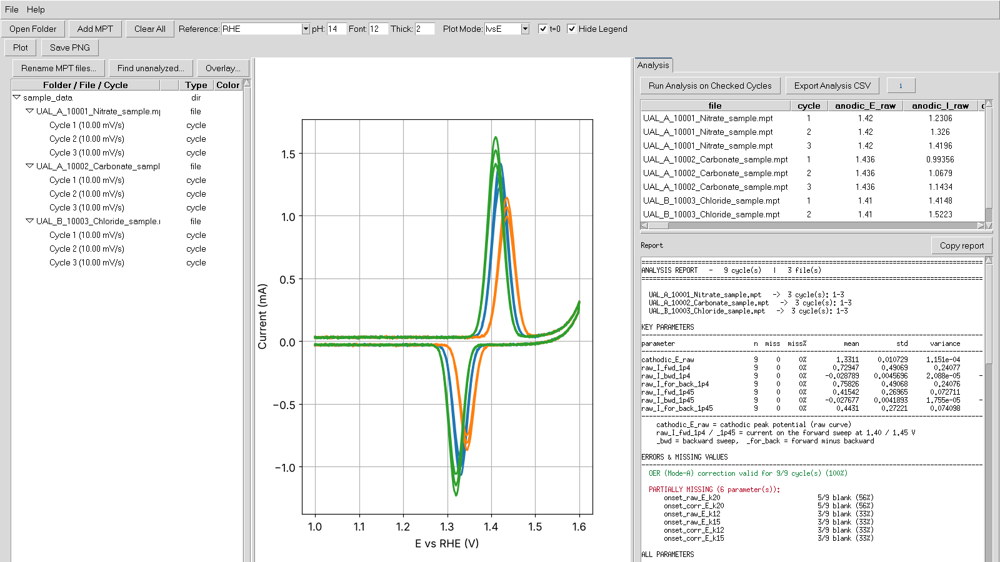
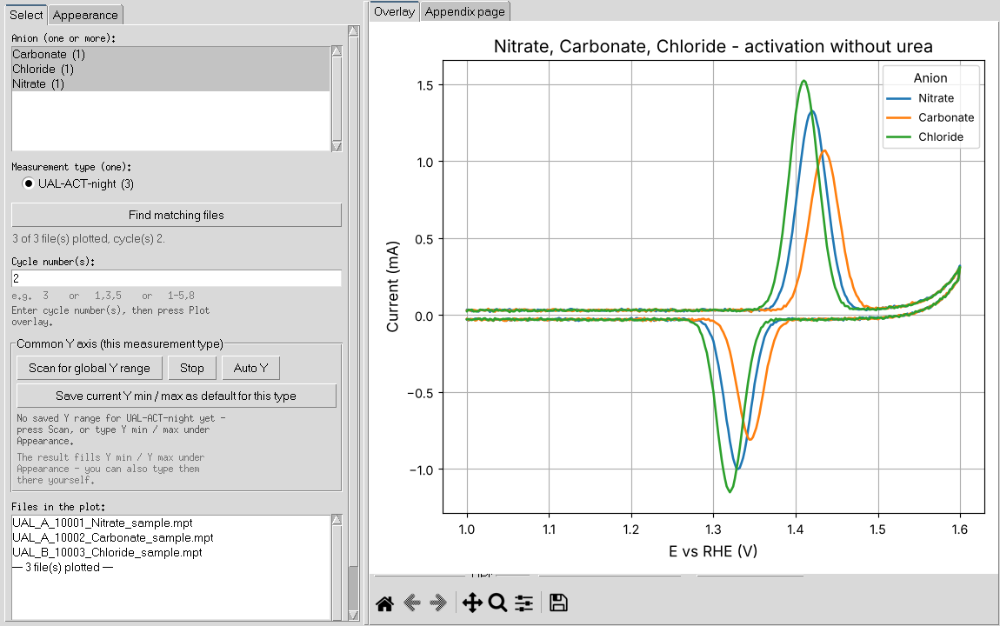

# CV Analyzer

A desktop tool for analyzing **cyclic voltammetry (CV)** data from BioLogic EC-Lab (`.mpt`) files: browse files and cycles, find redox peaks, integrate charge, correct for the OER background, and export per-cycle metrics to CSV in a few clicks.



## The problem

An electrocatalysis experiment produces many `.mpt` files, each with dozens to hundreds of CV cycles. Extracting the same numbers from every cycle (peak potentials and currents, charge, currents at fixed potentials, onset potentials) by hand in Excel or EC-Lab is slow, hard to keep consistent between people, and easy to get wrong.

## What it does

CV Analyzer turns that into a repeatable workflow:

**Open a folder → tick cycles → Run Analysis → Export CSV**

- **File and cycle browser**: every `.mpt` in a folder tree, with each cycle and its scan rate. Files are parsed lazily, so large folders open instantly.
- **Reference conversion**: potentials converted to RHE from common reference electrodes and the electrolyte pH.
- **Peak analysis**: anodic and cathodic peak potentials and currents within configurable windows.
- **Charge integration**: a Q vs E plot alongside I vs E, I vs t and E vs t.
- **OER background subtraction**: a corrected curve and corrected metrics, with a validity flag per cycle.
- **Onset potentials and derivatives**: first and second derivatives with live smoothing (moving average or Savitzky–Golay).
- **Currents at fixed potentials**: forward, backward and forward-minus-backward currents at set potentials.
- **Analysis report**: statistics for every parameter (n, missing values, mean, std, variance), with missing values flagged.
- **Batch processing**: *Find unanalyzed…* steps through every file without an export yet.
- **Overlay window**: compares the same cycle across many files, matched by name (for example by anion and measurement type), on a common Y axis.
- **Appendix page builder**: arranges graphs on a printable page and saves it as PNG or PDF.
- **Guided tutorial (English / Hebrew)**: runs on first launch on synthetic sample files, and every step waits until the user has actually done it.



## Quick start

Requires Python 3.9+ with Tkinter.

```bash
git clone https://github.com/Avivbryg/CV_analyzer.git
cd CV_analyzer
pip install -r requirements.txt
python cv_analyzer.py
```

On first launch the tutorial starts by itself. To try the program on the included data instead, click **Open Folder** and choose `sample_data/`.

> **Linux:** Tkinter may need to be installed separately, for example `sudo apt install python3-tk`.
> SciPy is optional; without it, smoothing falls back to a moving average.

## Sample data

`sample_data/` contains three **synthetic** CV files in EC-Lab ASCII format: a Ni(OH)₂-like redox couple vs RHE at 10 mV/s, 3 cycles each, with an OER tail above 1.5 V. They are generated by the program itself (`make_tutorial_samples`), so they contain no real experimental data.

File names follow the scheme `<measurement>_<station>_<electrode>_<anion>_<…>.mpt`. The export dialog and the overlay window read these parts from the name; any other name still works for analysis.

## Output

**Export Analysis CSV** writes one row per cycle with all computed metrics: raw and OER-corrected peak values, charges, onsets, and fixed-potential currents. The default export folder is `~/CV_Analyzer_exports`. Both the data folder and the export folder can be changed under **File → Set default folders…**, and the choice is remembered in `~/.cv_overlay_settings.json`.

## Background

I built this tool during my M.Sc. in Chemistry at the Technion, while studying how intercalated anions affect α-Ni(OH)₂ activity toward the urea oxidation reaction. It grew over many versions from a plotting script into the lab's analysis tool for CV data. It processes hundreds to thousands of cycles per experiment, and other researchers in the lab use it. The tutorial and folder setup were added so a new user can run it without help.

Built with Python, Tkinter, NumPy, Matplotlib and SciPy.

## License

MIT. See [LICENSE](LICENSE).
